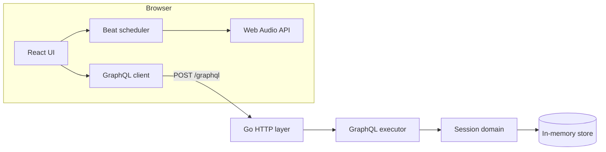

# metronome

A browser metronome with a practice log. The frontend generates click tracks with the Web Audio API, and a small Go GraphQL service records what you practiced.

> **Project history:** originally created in 2026 and modernized in 2026. See [CHANGELOG.md](CHANGELOG.md).

## Purpose

Musicians improve tempo control by practicing deliberately and tracking what they did. This project combines both steps in one screen: set a tempo, practice to a steady click, then log the session with notes.

It is also a compact example of a typed React client talking to a small Go GraphQL API with explicit request limits.

## What it does

- Plays a click at 30 to 300 BPM with 1 to 12 beats per bar.
- Supports quarter, eighth, triplet and sixteenth subdivisions.
- Offers four synthesized sounds (Click, Wood, Beep, Cowbell) and accents the first beat of each bar.
- Schedules clicks on the audio clock with a 120 ms lookahead, so timer jitter inside that window does not move them.
- Applies tempo, meter and sound changes while playing.
- Saves practice sessions and lists them newest first.

### Current limitations

- **Sessions are stored in memory** and are lost when the backend restarts.
- **There is no authentication.** The API binds to loopback by default and is intended for local use.
- Browsers throttle timers in background tabs, so playback can stutter while the tab is hidden.
- The meter is always displayed over 4.

## Architecture



```text
backend/
  cmd/server/          Process entry point and graceful shutdown
  internal/config/     Environment configuration
  internal/httpapi/    Routing, origin policy, rate limiting, headers
  internal/graphql/    Schema and query execution
  internal/session/    Domain rules and storage
frontend/src/
  app/                 Application composition
  features/metronome/  Tempo domain, scheduler, audio, hook, UI
  features/sessions/   Draft validation, API, hook, UI
  shared/api/          GraphQL client
db/schema.sql          Optional SQLite schema
scripts/               Schema check and test report generator
reports/tests/         Committed results of a real test run
```

Details and design decisions are in [docs/ARCHITECTURE.md](docs/ARCHITECTURE.md).

## Quick start

Requirements: Go 1.26.11 or newer, Node.js 24.15 or newer (`.nvmrc` pins 24.22.0), and `sqlite3` for the schema check.

```bash
make install

cd backend && go run ./cmd/server
```

In a second terminal:

```bash
cd frontend && npm run dev
```

Open <http://localhost:5173>.

## Usage guide

1. Set **BPM**, **Beats / Bar**, **Subdivision** and **Sound**.
2. Press **Start**. Browsers require this click before they allow audio.
3. Adjust the settings while playing if needed, then press **Stop**.
4. Enter the **Minutes** practiced and any **Notes**.
5. Press **Save Session**. The entry appears at the top of **Session History**.

### API

The service exposes `POST /graphql` and `GET /healthz`.

```bash
curl -s http://127.0.0.1:8080/graphql \
  -H 'Content-Type: application/json' \
  -d '{"query":"mutation { createSession(bpm: 120, beatsPerBar: 4, sound: \"Wood\") { id createdAt } }"}'

curl -s http://127.0.0.1:8080/graphql \
  -H 'Content-Type: application/json' \
  -d '{"query":"{ sessions { id bpm sound notes } }"}'
```

An operation may select `sessions` once and each session field once, so aliases cannot multiply the size of a response.

## Configuration

Backend environment variables:

| Variable | Default | Description |
| --- | --- | --- |
| `METRONOME_ADDR` | `127.0.0.1:8080` | Listen address |
| `METRONOME_ALLOWED_ORIGINS` | Local Vite dev and preview origins | Comma-separated exact browser origins in lowercase; wildcards are rejected |
| `METRONOME_RATE_LIMIT_PER_MINUTE` | `120` | GraphQL requests per client IP per minute |
| `METRONOME_MAX_SESSIONS` | `1000` | Maximum sessions held in memory |

Frontend build variables (see `frontend/.env.example`):

| Variable | Default | Description |
| --- | --- | --- |
| `VITE_GRAPHQL_URL` | `/graphql` | API endpoint; an absolute URL is added to the CSP `connect-src` |
| `VITE_DEV_PROXY_TARGET` | `http://127.0.0.1:8080` | Backend used by the dev and preview proxy |

## Database

[db/schema.sql](db/schema.sql) is an **optional** SQLite schema that mirrors the numeric ranges, allow-lists and notes length as constraints. The running backend does not use it; it is the starting point for adding durable storage.

```bash
sqlite3 metronome.db < db/schema.sql
```

## Testing

```bash
make test     # Go (race detector), TypeScript, Vitest, SQLite schema
make report   # Runs all suites and rewrites reports/tests/
make audit    # npm audit and govulncheck
```

The latest committed results are in [reports/tests/SUMMARY.md](reports/tests/SUMMARY.md).

## Security

The API enforces an origin allow-list, JSON-only requests, body and query cost limits, input validation and per-client rate limiting. It has no authentication. The production frontend ships a strict Content Security Policy. See [SECURITY.md](SECURITY.md) and [docs/SECURITY_AUDIT.md](docs/SECURITY_AUDIT.md).

## License

This repository does not currently include a license, so default copyright applies. Third-party packages keep their own licenses.
